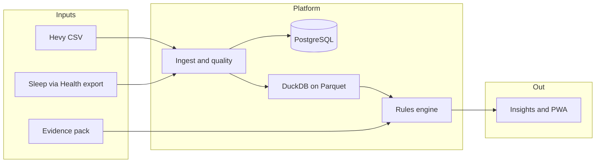

# GymFreak

**Evidence-based training insights on a real AI & data stack — then the app you actually use in the gym.**

GymFreak turns training history (and sleep from an Apple Health export) into explainable insights versus **cited literature ranges** — not a chatbot inventing a split or loads. The same system is the logger (PWA): gym, sleep, and diet on one calendar so those pillars reinforce each other.

> **Live:** [https://gymfreak.be](https://gymfreak.be)  
> **This repo is documentation only.** Application source stays private.  
> Not medical advice.

Built by [Lennaert De Schepper](https://www.linkedin.com/in/lennaert-de-schepper-b40649334) — Applied Informatics, **AI & Data Engineer**, HOGENT.

Product UI: **English-first**.

---

## The point

This is an **AI & data engineering** product with a gym front door.

You should be able to point at a real pipeline: ingest and quality checks on training (and sleep) exports, analytical tables on DuckDB/Parquet, a versioned evidence pack with cited ranges, and session proposals that a rules engine must accept before anything becomes kilos. The web app is how that system shows up; the stack behind it is the story.

Public demo: **anonymous aggregates** for guests. Logged-in users may upload their own Hevy CSV and see their own history. Raw health files are not in git.

---

## AI engineering

The interest signal is systems that stay honest under load — not a free-form coach.

| Layer | What it does |
|-------|----------------|
| **Rules + cited ranges** | Volume, frequency, stall heuristics, and sleep bands live in a versioned pack. App claims are either **method** (product decision) or **cited** (literature band). Papers support or challenge; they do not silently rewrite the product. |
| **Retrieval** | Search over a literature corpus so “why” can point at sources. Lexical search first; denser retrieval only if measured gains justify it. |
| **Proposals under the engine** | Session / routine suggestions must pass the same rules that own kilos and capacity. An LLM may paraphrase sources; it does **not** prescribe loads. |

LinkedIn one-liner: *Rules that branch by goal and load, retrieval over the papers you can cite, and a routine the engine has to accept.*

---

## Stack (high level)

Same *family* as Caddie (polyglot, Postgres as the only writer of user data). Different job. Hosted on Railway as **gymfreak.be** (same project as Caddie, own hostname).

| Layer | Choice | Role |
|-------|--------|------|
| Web / PWA | Next.js, React, TypeScript | Product site, insights, logger, legal |
| API | NestJS, TypeScript | Accounts, uploads, entitlements, engine path |
| Analytics | Python | Ingest, derive, evidence / batch analytics |
| OLTP | PostgreSQL | Users, files, job status — **only writer** of user data |
| OLAP | DuckDB on Parquet | Demo aggregates, analytical queries |
| Hosting | Railway | Always-on brand domain |

**Later / when metrics win** (not day-one production claims): time-series on the same Postgres, background queues, vector index for evidence if it beats the current search baseline, stronger ingest quality gates.

---

## What this repo is not

- Not the application source, evidence dumps, or raw training / health files.
- Not credentials, env files, schemas, or API maps.
- Not a security playbook and not a medical device.

All rights reserved. See [LICENSE](./LICENSE).
