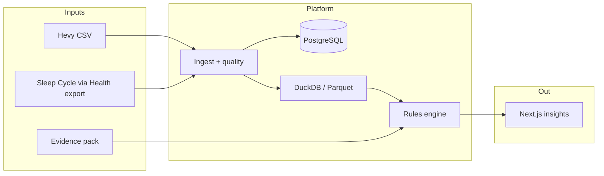

# GymFreak

**Evidence-based training insights — then the app you actually use in the gym.**

GymFreak starts as a companion on **Hevy exports** (and Sleep Cycle nights from an Apple Health export): ingest, quality, analytics, and comparisons to **cited literature** — not a chatbot inventing a split. Later it becomes the logger (offline-first), then diet + sleep as product, then social/habits, then the stores.

> **Live demo:** coming soon (always-on).  
> **This repo is documentation only.** Application source stays private.  
> Not medical advice.

Built by [Lennaert De Schepper](https://www.linkedin.com/in/lennaert-de-schepper-b40649334) — Applied Informatics, **AI & Data Engineer**, HOGENT.

Sister project (golf improvement): [Caddie_Public](https://github.com/Lennaertds/Caddie_Public).

Product UI: **English**.

---

## What a recruiter should take away

Job A is visible **data engineering + evidence-as-data**, not three charts. Job B (the long product) is a single system for train / eat / sleep — that is not the LinkedIn copy.

Public demo: **anonymous aggregates** only. Logged-in users may upload their own Hevy CSV and see their own history. Raw health files are not in git.

---

## Stack (high level)

Same *family* as Caddie (polyglot, Postgres as the only writer of user data). Different job.

| Layer | Choice | Job |
|-------|--------|-----|
| Web | Next.js 15, React, TypeScript | Product site, insights, legal |
| Public API | NestJS, TypeScript | Accounts, uploads, entitlements |
| Analytics | Python (FastAPI / CLI) | Hevy + Sleep Cycle ingest, engine batch |
| OLTP | PostgreSQL | Users, files, job status |
| Time-series | TimescaleDB (same Postgres) | Volume / progress / sleep by day |
| OLAP | DuckDB on Parquet | Demo aggregates, analytical queries |
| Vectors | pgvector (same Postgres) | Evidence passages / “why” (when wired) |
| Quality | Great Expectations (target) | Ingest / derived checks |
| Hosting | Railway (same project as Caddie, **own hostname**) | Always-on, one bill, two brand domains |

Phase 1 does **not** ship Expo, diet-as-product, or social. The engine compares volume, frequency, stall (heuristic: four sessions without a best-set improvement), and sleep to priors. An LLM may paraphrase sources; it does **not** prescribe loads.

---

## What this repo is not

- Not the application source, evidence YAML dumps, or raw training/health files.
- Not credentials, env files, schemas, or API maps.
- Not a medical device and not a Hevy clone on day one.

All rights reserved. See [LICENSE](./LICENSE).
